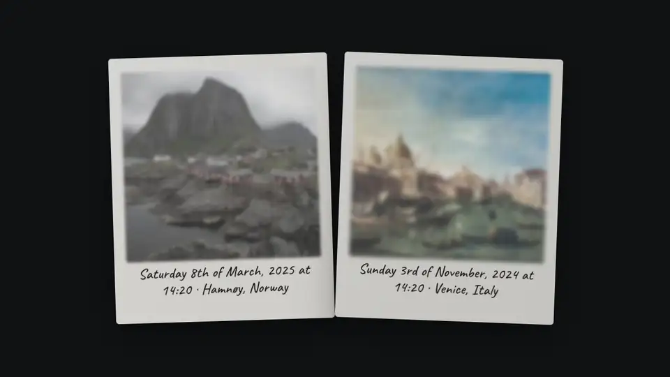
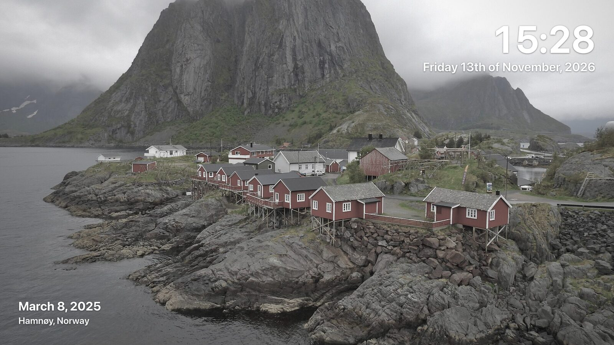
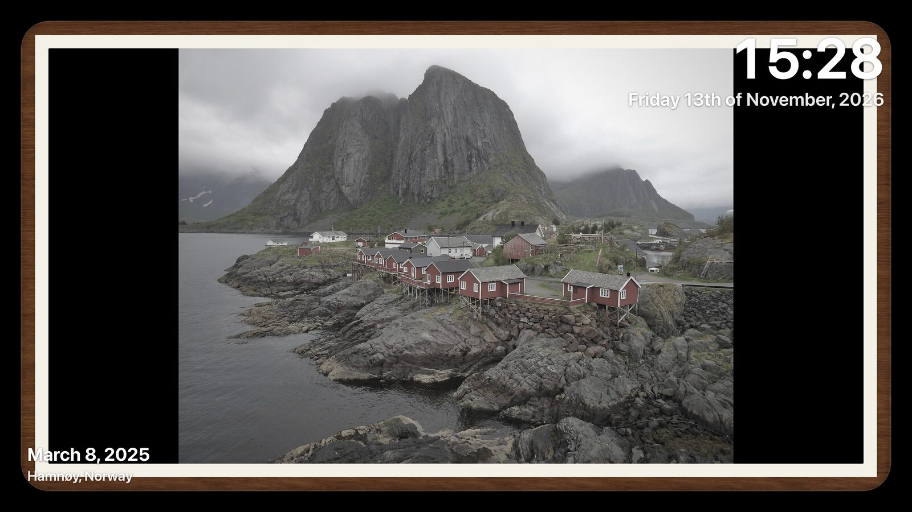
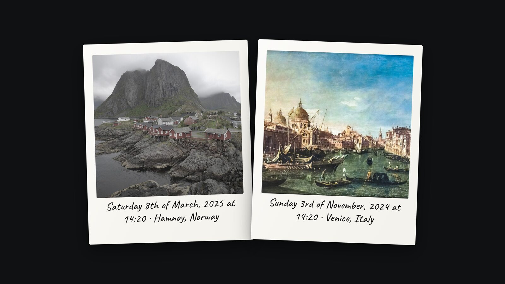
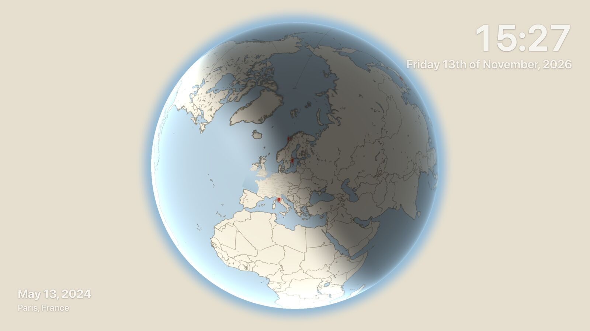
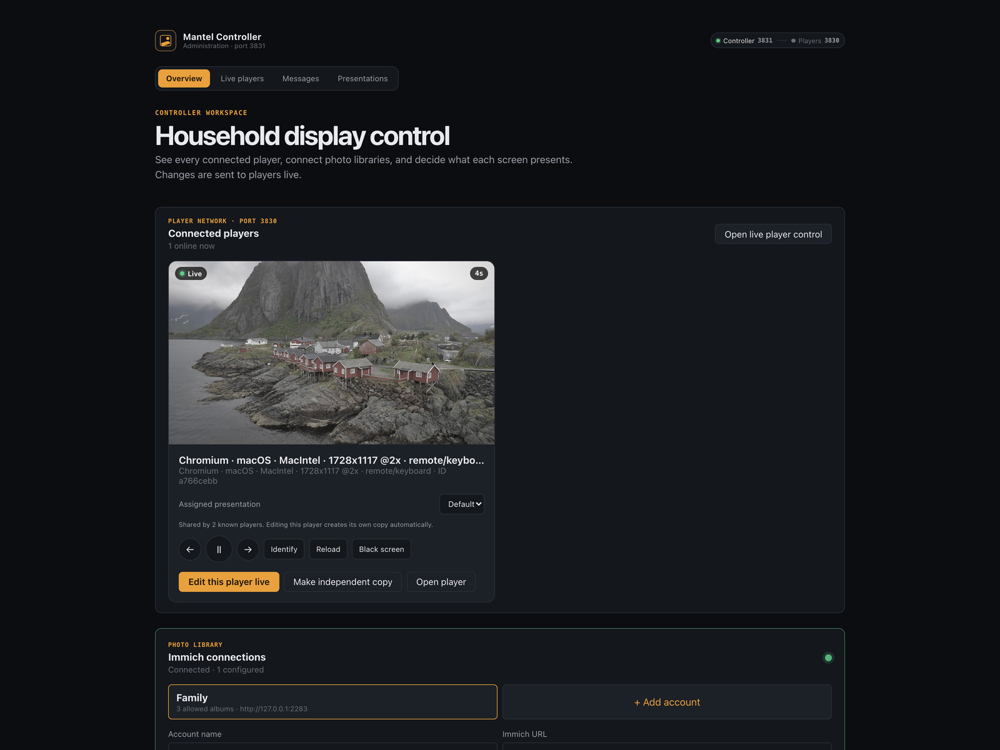

<h1 align="center">Mantel</h1>

<p align="center">
  <strong>A self-hosted digital photo frame for <a href="https://immich.app">Immich</a>.</strong><br>
  Point it at your Immich server, pick albums and people in a visual settings UI, and get a
  smooth slideshow on any screen in the house — TVs, tablets and Raspberry Pi displays included.
</p>

<p align="center">
  <a href="LICENSE"></a>
  
  
  
</p>

<p align="center">
  
</p>

Your photos never pass through anyone else's server, and neither does your Immich
key: the browser only ever talks to Mantel, and Mantel only ever reads.

## What it looks like

|  |  |
|---|---|
|  |  |
| **Full screen**, with the overlays you choose — clock, place, people, weather | **Gallery framing** — mat, border and a white, black, walnut or aluminium frame |
|  |  |
| **Instant table** — photos dealt as instant film and developing in place | **World map** — a self-hosted globe flies to each photo's location |

The controller runs on its own port, so a television never shows an admin screen:



Everything is configured visually, with a live preview and no YAML files:


## Features

- **Photo sources** — album-only safety, albums, recognized people, random libraries and "X years ago" memories, with named Immich accounts when needed
- **Once-per-cycle playback** — random, newest-first, or oldest-first ordering; every selected asset is used once before the next cycle begins
- **Persistent server image cache** — normal playback caches only what it uses; a separately confirmed album-only job can slowly cache the complete selection after showing its exact count and estimated size
- **Playback resume** — each screen resumes its remaining queue and cycle after a browser refresh or device restart
- **Face timeline** — centers one selected person using cached Immich face boxes, orders their photos chronologically, and can show their age when each photo was taken
- **Powerful filters** — date range, favorites, minimum rating, orientation, newest limit, and matching any or all selected people
- **Automatic players** — opening Player port 3830 creates or restores a device-specific presentation cloned from a configured screen; a kiosk never stops at a launcher or missing-profile page
- **World map journeys** — a self-hosted vector globe or flat map (Natural Earth, no tile servers) flies to each located photo, shows it as a floating card, split screen, or full screen, and returns; optional glanceable trivia about the place, offline or with one Wikipedia sentence
- **Independent presentation modes** — still images, five motion/face modes, six transition choices, natural/monochrome/art/noir treatments, single/adaptive/mosaic/moving-wall layouts, or random choices per composition
- **Screen-aware composition** — pair unused portraits on a television, pair unused landscapes on a portrait phone, give each photo its own rounded corners and complete metadata/people overlay, and choose contain or 16:9-filling crop independently
- **Mixed compositions** — optionally place one unused portrait beside two stacked unused landscape photos, with left/right/alternating placement and adjustable inter-photo spacing
- **Gallery framing** — independent edge margin, photo gap, corner radius, fine border, passpartout/mat, and optional white, black, walnut, or brushed-aluminium picture frames
- **Overlays and widgets** — clock/date, location or discovered Home Assistant weather, photo info, people and compact ages, Swedish calendar, custom messages, an OLED-safe ticker, rotating quotes/trivia, school meals, and live SL departures
- **Independent typography** — size and white, black, custom, or photo-opposite color per item, with nine placements from corners through side-centers and top-center
- **Photo framing** — live controls for edge margin, rounded corners, border width/color, background, image fit, quality, progress bar, and transitions
- **Web settings UI** — pick albums and people visually with thumbnails, live preview while you tweak; no YAML files
- **Gallery insights** — selected/cached counts and bytes, original size coverage, date span, orientations, ratings, locations, cameras, album members, recognized faces, and the current full-cycle viewing time
- **Live mobile controller** — host port 3831 shows the exact reported composition and countdown on every connected browser, provides playback controls and direct customization, and pushes changes to players automatically
- **Live Messages tab** — send a 5–60 second centered announcement or fast top/bottom ticker to one, several, or every online player
- **Player diagnostics** — reported viewport, pixel density, estimated refresh rate, CPU concurrency, and browser-exposed memory without inventing unavailable values
- **Stable player identity** — each browser keeps a private ID and reports a non-secret device/platform/screen fingerprint; friendly names and presentation assignments persist across reconnects
- **Built for always-on screens** — screen-off hours, wake lock, burn-in mitigation, pause/next/prev controls that work with touch and TV remotes
- **Light on hardware** — tiny client JS, compositor-only animations, image prefetch with decode off the main path; runs happily in a Raspberry Pi browser
- **Private by design** — your Immich API key never leaves the server; the browser only ever talks to Mantel

## Quick start (Docker)

1. In Immich, create the dedicated read-only key described in
   [docs/IMMICH_API_KEY.md](docs/IMMICH_API_KEY.md). Do not use **Select all**.
2. Copy `docker-compose.example.yml` to `docker-compose.yml` and run `docker compose up -d`.
3. Open `http://<host>:3831`. This is the **Mantel Controller**; add a named Immich account, paste one or more explicitly allowed album IDs or `/albums/...` URLs, and select **Test and save**.
4. Explicitly select an album in a presentation. Opening Player port `3830` creates a device-specific copy of the best configured presentation and starts it immediately. If no album is configured anywhere yet, the player stays safely black while remaining visible in the Controller. Use the album-only action before reviewing or starting a complete cache.

Configuration, the server-only Immich connection, and caches live in the host
directory given by `MANTEL_DATA_DIR` (default `./mantel-data`; on a Synology NAS,
`/volume1/docker/mantel-data` is the usual choice). No deployment `.env` is required.

### NAS image bundle

For a NAS that cannot pull from a registry, the lowercase [`mantel`](./mantel)
directory holds the handoff for the single-container deployment: `compose.yaml`
and `VERSION`. The image archive `mantel.tar.gz` is a build artifact and is not
kept in the repository — build it yourself. Immich is configured after startup
from the controller, so the bundle needs no `.env`. Build it with:

```sh
./scripts/export-nas-image.sh
```

The NAS does not need registry access: load the compressed image and start its
one container with the included Compose file.

```sh
docker load --input mantel.tar.gz
docker compose -f compose.yaml config --quiet
docker compose -f compose.yaml up -d --wait --wait-timeout 90
```

The final command exits successfully only after Mantel passes its health check,
or fails after 90 seconds instead of waiting indefinitely. Deployment creates
the data directory when needed, but does not
start a full-album cache job or copy photos into it.

The container drops to the dedicated `MANTEL_PUID:MANTEL_PGID` identity after
fixing only the `/data` mount point; it never recursively changes a large cache
at startup. A fresh Mantel directory works automatically. If you manually copy
an older volume into the data directory, ensure the copied files are
owned or writable by the configured IDs before starting, or temporarily retain
their previous numeric IDs for the migration. This prevents a redeploy from
stalling while traversing a large image cache.

### Environment variables

| Variable | Required | Description |
| --- | --- | --- |
| `IMMICH_URL` | no | Developer/migration fallback; normally saved from the controller |
| `IMMICH_API_KEY` | no | Developer/migration fallback; normally saved from the controller |
| `PORT` | no | Private in-container Player port (default `8780`) |
| `CONTROL_PORT` | no | Private in-container Controller port (default `8781`) |
| `MANTEL_BIND_ADDRESS` | no | NAS interface receiving published ports (default `0.0.0.0`, all interfaces; set a single IP to restrict) |
| `MANTEL_PLAYER_PORT` | no | Published Player host port (default `3830`) |
| `MANTEL_CONTROLLER_PORT` | no | Published Controller host port (default `3831`) |
| `MANTEL_PUID` | no | Dedicated numeric runtime UID (default `10001`) |
| `MANTEL_PGID` | no | Dedicated numeric runtime GID (default `10001`) |
| `DATA_DIR` | no | Config directory (default `/data` in Docker, `./data` in dev) |
| `MANTEL_DATA_DIR` | no | Compose host path for persistent data (default `./mantel-data`) |
| `TZ` | no | Timezone, used for memories and screen-off hours |
| `PLAYLIST_REFRESH_MINUTES` | no | How often source membership is refreshed from Immich (default `60`) |
| `IMMICH_UPDATE_POLL_MINUTES` | no | Minimum shared album-metadata check interval across all players (default `5`, minimum `1`) |
| `CACHE_CONCURRENCY` | no | Parallel downloads for a confirmed album cache, clamped to 1–8 (default `4`) |
| `IMAGE_CACHE_MAX_GB` | no | Ceiling for the persistent image cache; least-recently shown photos are evicted first (default `20`, `0` = unlimited) |
| `MANTEL_MEMORY_LIMIT` | no | Compose memory ceiling (default `2g`) |
| `MANTEL_MEMORY_RESERVATION` | no | Compose soft memory reservation (default `512m`) |
| `MANTEL_CPU_LIMIT` | no | Compose CPU ceiling (default `2.0`) |

### Home Assistant weather

Weather can use Mantel's location provider or a Home Assistant `weather.*`
entity. Location search accepts local names such as Täby or Näsbypark. In the
presentation editor choose **Home Assistant**, enter its URL and a long-lived
access token; Mantel discovers available `weather.*` entities and presents them
as a dropdown. Mantel saves the token server-side in `/data/home-assistant.json`
with mode 0600; players never receive it. Mantel only issues authenticated `GET`
requests to `/api/`, `/api/states`, and the selected entity's
`/api/states/<entity_id>` endpoint.
Prefer a dedicated non-administrator Home Assistant user because tokens inherit
their user's authority.

### Caching and playback cycles

Image files are stored in `DATA_DIR/image-cache`. Normal playback fetches and
caches only the current playlist page. It never silently warms a whole account.
For a display containing only explicit album sources, **Review offline cache**
enumerates the exact filtered selection and reports total/cached/missing assets
plus estimated additional disk use without downloading image bytes. The slow,
two-download job starts only after a second confirmation whose asset count must
still match. Cache clear and album-apply buttons also reset player queues so an
old collection cannot continue on the television.

Album-only players ask Mantel for updates every five minutes by default. Mantel
globally shares and throttles the result per presentation, so ten screens do not
turn into ten Immich checks. A changed count or update timestamp triggers one
re-enumeration, and newly discovered images go to the front of each active
queue. This is intentionally gentle polling—not a claimed Immich webhook. The
interval can be lowered to one minute, but never below one minute.

Each active playback cycle is also persisted in `DATA_DIR/playback-decks`.
Album changes therefore cannot shift page offsets or repeat/skip an existing
cycle, and a container restart resumes the same deck. The next cycle is rebuilt
from the updated album. At most 32 recent deck snapshots are retained.

The random source enumerates the library rather than taking a random sample.
Within a display cycle, assets are deduplicated and sent exactly once. The next
cycle gets a new deterministic shuffle. Selecting one person as the only source
and choosing **Oldest first** provides a chronological slideshow of photos that
Immich associates with that person.

### Players and presentations

A **player** is one connected browser or kiosk. A **presentation** is its saved
photo source and visual configuration. Several players may deliberately share a
presentation, but choosing **Edit this player live** automatically clones a
shared presentation and assigns the copy to only that player before opening the
editor. Editing one player therefore cannot silently change the others. The
editor follows the exact asset IDs, multi-image composition, pause state and
countdown reported by that browser; it does not start a second slideshow.

Before you give it a friendly name, a player is identified by its browser,
platform, screen resolution and stable short ID. This fingerprint contains no
Immich data and survives ordinary player reconnects through the browser's local
storage.

Players also post a small Mantel-only heartbeat every 20 seconds. This keeps
embedded Home Assistant browsers visible with their current photo even when
their long-lived command channel is unavailable; such cards are marked
**Online · embedded** until the channel reconnects. Heartbeats never call
Immich.

Enable **Face timeline**, select one person, and choose **Oldest first** for a
chronological, face-centered sequence. Face responses are persisted in
`DATA_DIR/face-cache`, so each asset's metadata is normally requested from
Immich only once. If Immich has a birth date, Mantel can calculate the person's
age when the photo was taken. This live mode does not run eye-alignment, pose,
blink, or blur ML filters and does not compile an MP4; those remain an optional
offline production pipeline rather than work suitable for every NAS slide.

### Planned video playback

Video assets remain deliberately excluded from image playlists in v0.0.12 so a
shared clip cannot become a blank slide. The planned video path will add
server-cached range streaming, poster frames, duration-aware scheduling,
muted/autoplay controls, optional audio, transcoding compatibility reporting,
and the same once-per-cycle accounting used by photographs.

### Multiple Immich accounts

Start with one key from the account that can see the shared family album and has
the most useful person names. Add the Camera account as a second named connection
only for its private albums or its owner-specific face catalogue. Do not add all
family accounts by default. Immich recognition belongs to the asset owner:
another account's face names do not become available merely because it shares an
album, and Mantel never guesses those identities. Each named connection uses its
own nine-permission read-only key and cache namespace.

### Dashboard widgets

Widgets are configured in the display settings UI and saved with the display
profile—there is no widget config file. Every service can be shown as a normal
information card or flattened into a top/bottom ticker. Built-ins include custom
messages, a scrolling reminder/news ticker, 15–60 minute rotating quotes and trivia, location or
Home Assistant weather, optional Swedish holidays/name days/week number, and
Swedish school lunches. An SL widget includes Roslagsbanan at Galoppfältet and
nearby buses from Kemistvägen by default, polls Mantel once per minute, and shows
the required Trafiklab/SL attribution. Text overlays use bold type and layered shadows rather
than fixed translucent panels; they still participate in the OLED hide/shift
cycle.
The lunch widget accepts the school segment from `skolmaten.se/<school>`. It
uses Skolmaten's current read API, caches results for one hour, shows today plus
next week on weekdays (the coming week on weekends), deduplicates identical
dishes, and scrolls the compact fixed-height card. Mantel contacts only that
fixed host. SL Transport's public departures endpoint does not require a key;
Mantel caches and shares its result so multiple screens do not multiply requests.

The separate **Messages** tab is live-only: it can target all online players or
selected screens with a temporary centered popup or ticker. Players report an
animation-frame-derived refresh-rate estimate and browser-available device
metrics there. CSS ticker motion is composited and naturally synchronized to
the player's refresh cycle; its configured seconds-per-pass determines speed.

## Development

```sh
npm install
npm run dev            # http://localhost:5173
# Open /settings to configure Immich. Developers may still use .env + npm run smoke.
npm test               # unit tests
npm run check          # type check
```

The related-project review and prioritized feature backlog are documented in
[docs/RELATED_PROJECTS.md](docs/RELATED_PROJECTS.md).

## World map layout

Choose **World map** under Playback → Screen layout. The player rests on a
world view, flies to a place where you have photos, shows one photo there for
the configured hold time, zooms back out and continues to the next place. Every
place is visited in turn with one photo per visit, so a holiday with 300 photos
never monopolises the screen, and every located photo still appears once per
cycle. Photos without GPS coordinates are left out of this layout.

Everything the map needs lives on your NAS, and nothing is fetched while a
frame is playing.

| Data | Source | Where |
| --- | --- | --- |
| Countries, lakes, regions, rivers, roads, place polygons, country facts | Natural Earth (public domain) | in the image |
| 151,000 settlement names: Europe from 500 people up, the world from 5,000 | GeoNames (CC BY 4.0) | in the image |
| Globe textures for all twelve months, night lights | NASA Blue Marble / Black Marble (public domain) | in the image |
| Blue Marble and relief backdrop blocks (2048 px WebP) | NASA / Natural Earth | `mantel-data/map` |
| Sentinel-2 cloudless close-ups (4096 px WebP) | EOX, modified Copernicus Sentinel data | `mantel-data/map` |
| Roads, rail, rivers, lakes and settlements around each photo place | OpenStreetMap (ODbL) | `mantel-data/map-cache` |

Build the data once with `node scripts/build-map-data.mjs`,
`node scripts/build-map-textures.mjs` and `node scripts/build-map-tiles.mjs`
(the last takes a region: Europe at levels 4–7 is about 1,400 blocks and 3 GB).
The imagery is served through Mantel itself, so players never talk to any map
service. Anything missing around a photo place is fetched once, in the
background, and kept. Mantel is a private local app, so the players show no
attribution line; the sources are credited in the presentation editor and here.

The **World map** section of the presentation editor controls:

- **World** — globe or flat map; globe engine (the full-screen shader, or a
  Three.js textured sphere, so you can compare smoothness on the television);
  Midnight, Atlas or Ink styling; satellite, relief or vector-only imagery; the
  Blue Marble month following the season; Sentinel-2 close-ups or Blue Marble
  only; OpenStreetMap regional detail; real-sun lighting with a moving
  day/night terminator and city lights, or a studio lamp; detail layers,
  markers, labels, grid, and the slow turn between stops
- **Journey** — photo hold time (5–60 s), flight time, rest time on the world
  view, and the ground width of the arrived view (city to continent)
- **Photo** — floating card, split screen or full screen. Split screen has an
  adjustable divider (the map can keep 30–70% of the width), a panel colour with
  an optional fade into the map, and photos that either fill the panel with a
  face-aware crop (always, portraits only, landscapes only, or never) or show
  whole; card height; a clean or feathered edge that dissolves into the map; and
  depth: flat, hovering on a deep shadow, or turned in three dimensions to face
  the place it belongs to;
  placement next to the place (never over the corners, with a leader line to
  the pin) or on a fixed side; border, Instant or no frame; border width and
  colour; corner radius; drop shadow; caption; whether the corner overlays stay
  visible (photo and cards then keep out of the top and bottom bands)
- **Place card** — off, offline facts, or facts plus online extras; full ladder
  or short; card size. Map names are big by default and adjustable; the photo's
  own place is named at the pin in the marker colour, and a handful of the
  largest places near it follow. You set the smallest place worth naming and how
  many names may share the screen; height raises the floor by itself, so a
  country shows cities and a valley shows villages. No name is ever repeated. In card mode it sits on the other side of the pin from
  the photo, as close to the city as the photo is, and never over the photo. Offline: place, region, island, country and continent from the
  bundled atlas; local time; sunrise and sunset; population and capital status;
  country population and subregion; distance from your home base; photo count.
  Online (fetched once in the background and cached on the server): street,
  neighbourhood and town from OpenStreetMap's Nominatim, one Wikipedia
  sentence, and the weather right now from Open-Meteo. The home base is
  searchable; it falls back to the weather location.

Flights turn the world to the city first, then dive on it. They are rendered on
the GPU from the earth imagery and a vector-drawn atlas; the arrived view is
redrawn crisply by the CPU with Sentinel tiles underneath. Two progressively
tighter detail atlases keep the last part of the flight sharp.
A device without WebGL still works, with dissolves instead of flights.

## Remote control

Open `http://<host>:3831` on any desktop or phone. This page is the **controller**. Every screen currently showing a slideshow appears as a responsive card with its exact current image set and live seconds-remaining counter. From there you can:

- switch which display profile a screen is playing
- pause/resume and skip back/forward
- **Identify** — flashes the display's name on that screen so you know which is which
- rename devices (click the device name)
- temporarily black out and wake a player, or reload its browser
- open **Customize live**; autosaved changes are pushed to every player using that profile

The Settings home also contains a larger live player gallery with the same controls. “Black screen” is a reversible OLED-safe browser blackout; powering off or rebooting a Raspberry Pi requires a separately enrolled host helper and is not impersonated by the web player.

## Kiosk tips (Raspberry Pi + TV)

The complete setup for the living-room Raspberry Pi and LG OLED—including the
known 4K60 boot settings, tracked Chromium launcher, TV settings, verification,
and limitations—is in [raspberry-pi/README.md](raspberry-pi/README.md).

On a Raspberry Pi with an attached screen, run Chromium in kiosk mode pointed at your display URL:

```sh
chromium-browser --kiosk --noerrdialogs --disable-session-crashed-bubble \
  http://<host>:3830/display/auto
```

### TV remote via HDMI-CEC

When the Pi is plugged into the LG TV over HDMI, Simplink forwards supported
remote buttons through HDMI-CEC. Chromium does not reliably consume raw CEC
events, so install Mantel's native bridge from `raspberry-pi/`; it translates
them into the keyboard/media events the slideshow understands:

| Remote button | Action |
| --- | --- |
| ◀ / ▶ (arrows) | previous / next photo |
| OK / Enter / Play-Pause | pause / resume |
| ▲ | show the control bar (never pauses) |
| ▼ | open the large command ribbon |
| Back / Exit | hide the control bar |

A paused player is never mistaken for a frozen one: a small **Paused** badge
sits in the bottom-right corner, and playback resumes on its own after the
minutes set under **Playback → After a pause, resume by itself** (5 by
default; 0 keeps it paused until someone presses play).

The ribbon includes previous/next, pause, hide all text, photo info, fit/fill,
still motion, monochrome, person-only playback for recognized people in the
current composition, and a temporary **Random everything** mode. **Restore
saved setup** clears all temporary overrides and returns to the presentation
saved in the Controller.

Enable LG **Simplink** first. Installation, service management, direct CEC
testing, Wayland key injection, logs, and rollback are documented in
[raspberry-pi/README.md](raspberry-pi/README.md#lg-remote-through-hdmi-cec).

## Project policies

| | |
|---|---|
| [PRIVACY.md](PRIVACY.md) | What is stored, what leaves your network, and how to switch each of those off |
| [SECURITY.md](SECURITY.md) | How to report a vulnerability privately, and what is in scope |
| [CONTRIBUTING.md](CONTRIBUTING.md) | How to run it locally, what the project will and will not accept |
| [CODE_OF_CONDUCT.md](CODE_OF_CONDUCT.md) | Be decent — the longer version |

Two promises worth stating up front: **Mantel has no telemetry, no account and no
cloud component**, and **Mantel never writes to Immich**. It asks for a read-only
key and uses it to read.

One thing to know before you expose it: Mantel has **no authentication**, on
purpose, the way a printer's admin page does not. Keep it on your home network
and reach it from outside through a VPN or an authenticating reverse proxy.

## Licence

Mantel is free software under the **GNU Affero General Public License v3.0 or later**.
You may run, study, modify and share it. If you distribute a modified version, or run one
as a network service that other people use, you must offer those users the corresponding
source under the same licence. See [LICENSE](LICENSE).

Bundled fonts, textures and map imagery keep their own licences; see
[THIRD-PARTY-NOTICES.md](THIRD-PARTY-NOTICES.md).

Mantel is an independent project and is not affiliated with or endorsed by the Immich project.

Copyright © 2026 Alex Roman.
