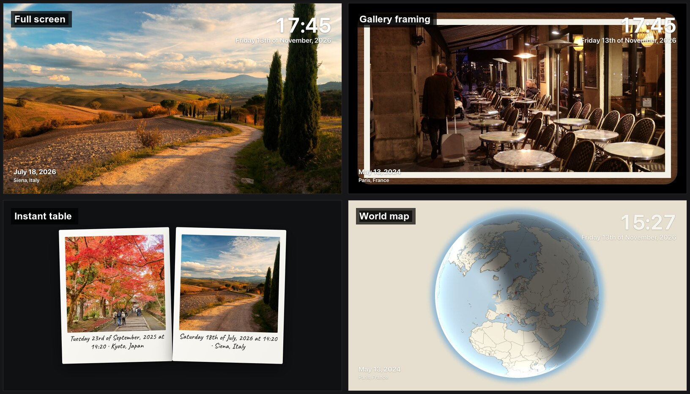
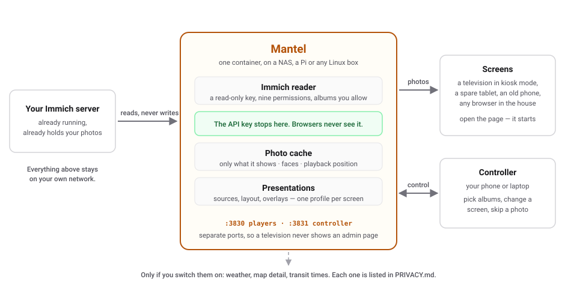

<h1 align="center">Mantel</h1>

<p align="center">
  <strong>Turn any screen in your home into a photo frame for your <a href="https://immich.app">Immich</a> library.</strong>
</p>

<p align="center">
  <a href="LICENSE"></a>
  
  
  
</p>

<p align="center">
  
</p>
<p align="center"><em>One album, four ways. Screenshots from the running app.</em></p>

Your photos are already somewhere good. They are just not where you can see
them.

Mantel is a small web app you run yourself. Point it at Immich, choose a few
albums, and open a page on whatever you want to look at — a tablet on the
shelf, an old phone, the television. Your phone becomes the remote.

No account. No cloud. No subscription. Nothing leaves your network.

---

## See it

- **Full screen** — the photo, and only the overlays you choose
- **Gallery framing** — a mat, a border, and a white, black, walnut or aluminium frame
- **Mosaic** — several photos at once, paired to suit the shape of the screen
- **Instant table** — photos dealt out as instant film, developing as you watch
- **World map** — a self-hosted globe flies to the place each photo was taken

<p align="center">
  
</p>
<p align="center"><em>Everything is set visually, with a live preview. No configuration files.</em></p>

## Why you might want it

**It shows photos, not a slideshow of everything.** Pick albums and people.
Nothing is ever selected for you. Every photo in a cycle appears exactly once
before any repeats.

**It makes them look good.** Portraits pair up on a wide television and
landscapes pair up on an upright phone, automatically. Mats, frames, motion,
monochrome, and a globe that flies to where each photo was taken.

**It is yours.** No account, no telemetry, no cloud, no subscription. The API
key it asks for is read-only — **Mantel can never change your library**.

**It runs on whatever you have.** One container on a laptop, a mini PC, a NAS,
a Pi. Screens are just browsers. The client is small enough for cheap hardware.

**It behaves like an appliance.** It resumes where it left off after a restart.
It blanks overnight. It shifts overlays to protect OLED panels. If nothing is
configured yet it stays black rather than showing your living room an error.

## How it works

<picture>
  <source media="(prefers-color-scheme: dark)" srcset="docs/media/architecture-dark.svg">
  
</picture>

One container reads Immich and serves two pages: the **screens** that show
photos, and the **controller** where you set things up. They are on separate
ports so a television never shows an admin page.

Your Immich key stays on the server. A browser never sees it.

## Get started

```sh
cp docker-compose.example.yml docker-compose.yml
docker compose up -d
```

Then open `http://<host>:3831`, paste a read-only Immich key and an album, and
open `http://<host>:3830` on something with a screen.

The image is prebuilt for amd64 and arm64 — there is nothing to compile. You
can build it yourself instead; it is one line in the Compose file.

**→ [Full installation guide](docs/INSTALL.md)**, including what you need, how
to make a safe Immich key, and what to do when it does not work.

> **This is self-hosted software.** You need an Immich server, somewhere to run
> a container, and enough comfort with Docker to read a log when something does
> not start. It is not an app you install on a TV.

## Documentation

| | |
|---|---|
| [Installing](docs/INSTALL.md) | Requirements, first run, troubleshooting |
| [Screens](docs/SCREENS.md) | Getting a browser to behave like a photo frame |
| [Everything it does](docs/FEATURES.md) | The complete feature list |
| [Configuration](docs/CONFIGURATION.md) | Settings, environment variables, caching |
| [Controlling screens](docs/REMOTE_CONTROL.md) | The controller, remotes, live messages |
| [World map](docs/WORLD_MAP.md) | The globe, and its offline map data |
| [Overlays and widgets](docs/WIDGETS.md) | Clocks, weather, tickers, messages |
| [Instant mode](docs/INSTANT_MODE.md) | The instant-film table |
| [Architecture](docs/ARCHITECTURE.md) | How it is built, for contributors |

## Policies

| | |
|---|---|
| [Privacy](PRIVACY.md) | What is stored, what leaves your network, how to switch each off |
| [Security](SECURITY.md) | Reporting a vulnerability privately, and what is in scope |
| [Contributing](CONTRIBUTING.md) | Running it locally, what the project will and will not accept |
| [Code of conduct](CODE_OF_CONDUCT.md) | Be decent — the longer version |

One thing to know before you expose it: **Mantel has no authentication**, on
purpose, the way a printer's admin page does not. Keep it on a network you
control, and reach it from outside through a VPN or an authenticating proxy.

## Licence

Free software under the **GNU Affero General Public License v3.0 or later**. Run
it, study it, change it, share it. If you distribute a modified version — or run
one as a network service other people use — you must offer those users the
corresponding source under the same licence. See [LICENSE](LICENSE).

Bundled fonts, textures and map data keep their own licences; see
[THIRD-PARTY-NOTICES.md](THIRD-PARTY-NOTICES.md).

Mantel is an independent project, not affiliated with or endorsed by Immich.

Copyright © 2026 Alex Roman.
