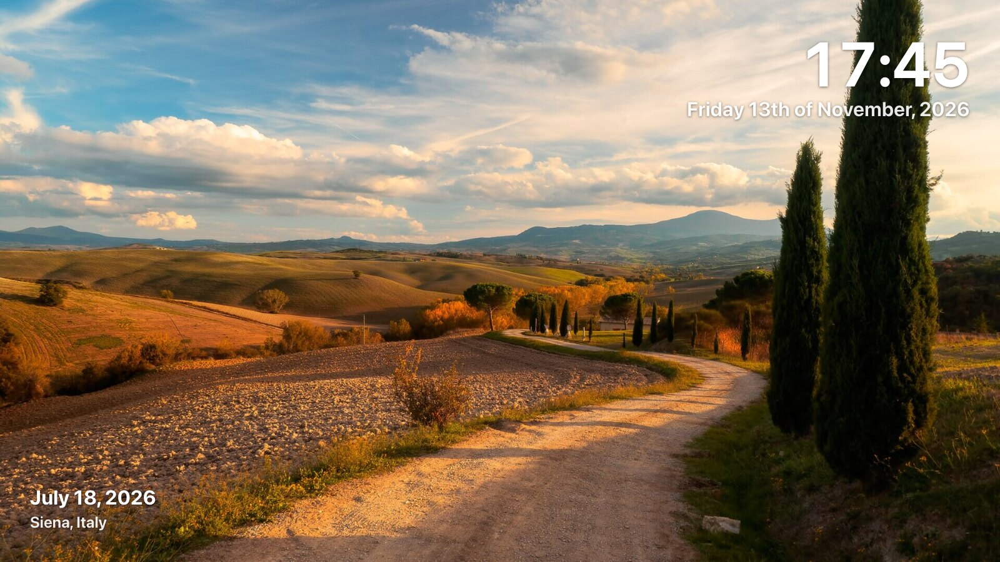
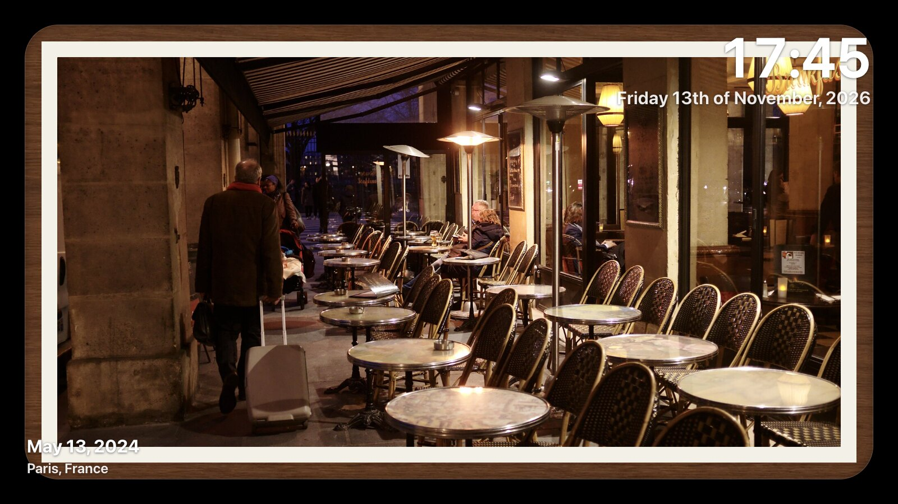
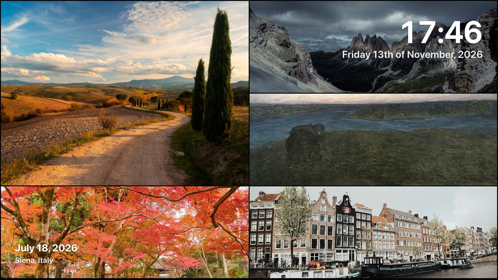
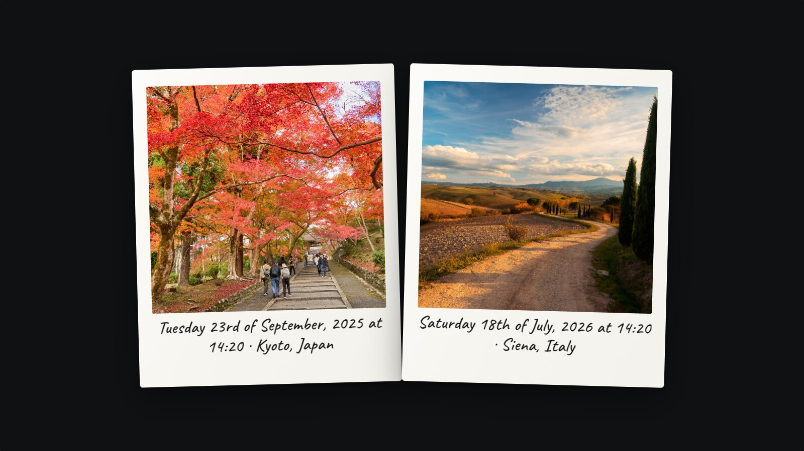

# Everything Mantel does

The [README](../README.md) covers the highlights. This is the complete list, for
anyone deciding whether it does the specific thing they need.

## Choosing photos

- **Sources** — albums, recognized people, random libraries, and "X years ago"
  memories, with named Immich accounts when you need more than one
- **Album-only safety** — nothing is selected by default; Mantel never decides
  to show you your whole library
- **Filters** — date range, favourites, minimum rating, orientation, newest
  limit, and matching any or all selected people
- **Gallery insights** — selected and cached counts and bytes, original-size
  coverage, date span, orientations, ratings, locations, cameras, album members,
  recognized faces, and how long one full cycle takes to watch

## Playback

- **Once-per-cycle** — random, newest-first or oldest-first ordering; every
  selected photo is shown once before the next cycle begins
- **Resume** — each screen resumes its remaining queue and cycle after a refresh
  or a device restart
- **Persistent server cache** — normal playback caches only what it uses; a
  separately confirmed album-only job can cache a complete selection after
  showing its exact count and estimated size first
- **Face timeline** — centres one person using cached Immich face boxes, orders
  their photos chronologically, and can show their age in each one
- **Automatic players** — opening the player port creates or restores a
  device-specific presentation cloned from a configured screen, so a kiosk never
  stops at a launcher or a missing-profile page

## Layout and composition

| | |
|---|---|
|  |  |
| **Full screen** — the photo, and only the overlays you choose | **Gallery framing** — mat, border and a white, black, walnut or aluminium frame |
|  |  |
| **Mosaic** — several photos at once, paired to suit the screen | **Instant table** — photos dealt out as instant film, developing in place |

- **Presentation modes** — still images, five motion and face modes, six
  transitions, natural/monochrome/art/noir treatments, single/adaptive/mosaic/
  moving-wall layouts, or a random choice per composition
- **Screen-aware composition** — pairs unused portraits on a television, pairs
  unused landscapes on a portrait phone, gives each photo its own rounded
  corners and complete metadata overlay, and lets you choose contain or
  16:9-filling crop independently
- **Mixed compositions** — one unused portrait beside two stacked unused
  landscapes, with left/right/alternating placement and adjustable spacing
- **Gallery framing** — independent edge margin, photo gap, corner radius, fine
  border, passepartout mat, and optional white, black, walnut or
  brushed-aluminium picture frames
- **Photo framing** — live controls for edge margin, rounded corners, border
  width and colour, background, image fit, quality, progress bar and transitions
- **Instant table** — photos dealt as instant film and developing in place; see
  [INSTANT_MODE.md](INSTANT_MODE.md)
- **World map** — a self-hosted globe or flat map flies to each located photo;
  see [WORLD_MAP.md](WORLD_MAP.md)

## On screen

- **Overlays** — clock and date, place, Home Assistant or location weather,
  photo info, people and compact ages, Swedish calendar, custom messages, an
  OLED-safe ticker, rotating quotes and trivia, school meals, live SL departures
- **Independent typography** — size and white, black, custom or photo-opposite
  colour per item, with nine placements
- See [WIDGETS.md](WIDGETS.md) for all of it

## Control

- **Live mobile controller** — shows the exact reported composition and
  countdown for every connected browser, with playback controls and direct
  customization pushed to players automatically
- **Live Messages tab** — a 5–60 second centred announcement or a fast ticker,
  to one, several or every online player
- **TV remotes** — HDMI-CEC on a Raspberry Pi; see
  [REMOTE_CONTROL.md](REMOTE_CONTROL.md)
- **Player diagnostics** — reported viewport, pixel density, estimated refresh
  rate, CPU concurrency and browser-exposed memory, without inventing values
  the browser does not provide
- **Stable player identity** — each browser keeps a private ID and reports a
  non-secret device, platform and screen fingerprint; friendly names and
  presentation assignments survive reconnects

## Living in a house

- **Built for always-on screens** — screen-off hours, wake lock, burn-in
  mitigation, and pause/next/previous that work with both touch and TV remotes
- **Light on hardware** — tiny client JS, compositor-only animations, image
  prefetch with decode off the main path; runs happily in a Raspberry Pi browser
- **Web settings UI** — pick albums and people visually, with thumbnails and a
  live preview; no YAML files

## Deliberately not there

- **No authentication** — by design, like a printer's admin page. Keep it on
  your home network; see [SECURITY.md](../SECURITY.md)
- **No writing to Immich** — the key it asks for cannot modify your library
- **No telemetry, no account, no cloud**
- **No video yet** — video assets are excluded on purpose so a clip cannot
  become a blank slide; the planned path is described in
  [CONFIGURATION.md](CONFIGURATION.md#planned-video-playback)
