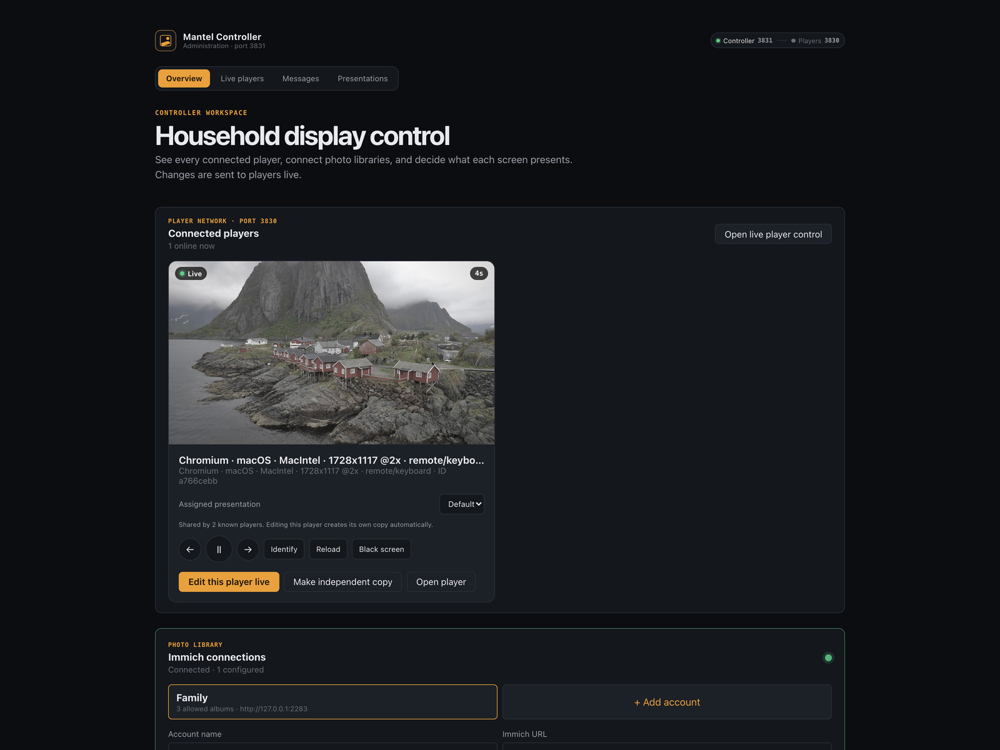

# Controlling your screens

## The controller

Open `http://<host>:3831` on any desktop or phone.

Every screen currently playing appears as a card showing its **exact current
image set** and a live seconds-remaining counter. From there:

- switch which presentation a screen is playing
- pause, resume, skip back and forward
- **Identify** — flashes the screen's name on that display, so you know which is which
- rename a device (click its name)
- black out and wake a screen, or reload its browser
- open **Customize live** — autosaved changes are pushed to every screen using that presentation

The controller home also has a larger live gallery with the same controls.

**Black screen** is a reversible, OLED-safe browser blackout. Mantel cannot
power off or reboot the device a browser is running on, and does not pretend to.

## Pausing

A paused screen is never mistaken for a frozen one: a small **Paused** badge
sits in the bottom-right corner.

Playback resumes by itself after the minutes set under **Playback → After a
pause, resume by itself** — 5 by default; `0` keeps it paused until someone
presses play.

## The command ribbon

Available on the screen itself, from touch or a remote:

previous and next · pause · hide all text · photo info · fit or fill · still
motion · monochrome · person-only playback for recognized people in the current
composition · a temporary **Random everything** mode

**Restore saved setup** clears every temporary override and returns to the
presentation saved in the controller.

## TV remotes over HDMI-CEC

Browsers do not reliably receive raw HDMI-CEC events, so a small bridge has to
translate them into ordinary key events. One is included for Linux single-board
computers in [`raspberry-pi/`](../raspberry-pi) as a worked example; the same
idea applies anywhere.

Once something is translating them, Mantel responds to:

| Remote button | Action |
| --- | --- |
| ◀ / ▶ | previous / next photo |
| OK / Enter / Play-Pause | pause / resume |
| ▲ | show the control bar (never pauses) |
| ▼ | open the command ribbon |
| Back / Exit | hide the control bar |

Installation, service management, direct CEC testing, key injection, logs and
rollback for that example are documented in
[raspberry-pi/README.md](../raspberry-pi/README.md#lg-remote-through-hdmi-cec).

## Live messages

The **Messages** tab is live-only. It can target every online screen or a chosen
few with a centred popup (5–60 seconds) or a fast ticker along the top or
bottom. Nothing is saved to the presentation — it appears, then it is gone.

See [WIDGETS.md](WIDGETS.md).
