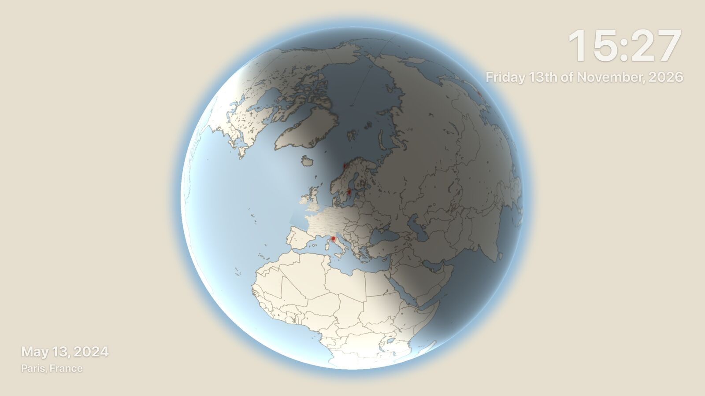

# World map



Choose **World map** under Playback → Screen layout.

The player rests on a world view, flies to a place where you have photos, shows
one photo there for the configured hold time, zooms back out, and continues to
the next place.

Every place is visited in turn with **one photo per visit**, so a holiday with
300 photos never monopolises the screen — and every located photo still appears
once per cycle. Photos without GPS coordinates are left out of this layout.

**Everything the map needs lives on your own machine.** Players never talk to a
map service, and nothing is fetched while a frame is playing.

## Where the map data comes from

| Data | Source | Where it lives |
| --- | --- | --- |
| Countries, lakes, regions, rivers, roads, place polygons, country facts | Natural Earth (public domain) | in the image |
| 151,000 settlement names: Europe from 500 people up, the world from 5,000 | GeoNames (CC BY 4.0) | in the image |
| Globe textures for all twelve months, night lights | NASA Blue Marble / Black Marble (public domain) | in the image |
| Blue Marble and relief backdrop blocks (2048 px WebP) | NASA / Natural Earth | `mantel-data/map` |
| Sentinel-2 cloudless close-ups (4096 px WebP) | EOX, modified Copernicus Sentinel data | `mantel-data/map` |
| Roads, rail, rivers, lakes and settlements around each photo place | OpenStreetMap (ODbL) | `mantel-data/map-cache` |

Anything missing around a photo's place is fetched once, in the background, and
kept.

Because Mantel is a private local app, players show no attribution line; the
sources are credited in the presentation editor, here, and in
[THIRD-PARTY-NOTICES.md](../THIRD-PARTY-NOTICES.md).

## Building the data

Run these once:

```sh
node scripts/build-map-data.mjs
node scripts/build-map-textures.mjs
node scripts/build-map-tiles.mjs
```

The last one takes a region. **Europe at levels 4–7 is about 1,400 blocks and
3 GB** — check your disk before starting it.

## What you can change

The **World map** section of the presentation editor controls four groups.

### World

Globe or flat map. Globe engine — the full-screen shader, or a Three.js textured
sphere, so you can compare smoothness on your own television. Midnight, Atlas or
Ink styling. Satellite, relief or vector-only imagery. The Blue Marble month
following the season. Sentinel-2 close-ups or Blue Marble only. OpenStreetMap
regional detail. Real-sun lighting with a moving day/night terminator and city
lights, or a studio lamp. Detail layers, markers, labels, grid, and the slow
turn between stops.

### Journey

Photo hold time (5–60 s), flight time, rest time on the world view, and the
ground width of the arrived view — anywhere from a city to a continent.

### Photo

Floating card, split screen or full screen.

Split screen has an adjustable divider (the map keeps 30–70% of the width), a
panel colour with an optional fade into the map, and photos that either fill the
panel with a face-aware crop — always, portraits only, landscapes only, or never
— or show whole.

Also: card height; a clean or feathered edge that dissolves into the map; and
depth — flat, hovering on a deep shadow, or turned in three dimensions to face
the place it belongs to.

Placement sits next to the place, never over the corners, with a leader line to
the pin; or on a fixed side. Border, Instant or no frame; border width and
colour; corner radius; drop shadow; caption; and whether the corner overlays
stay visible, in which case the photo and cards keep out of the top and bottom
bands.

### Place card

Off, offline facts, or facts plus online extras. Full ladder or short. Card
size.

Map names are big by default and adjustable. The photo's own place is named at
the pin in the marker colour, and a handful of the largest places near it
follow. You set the smallest place worth naming and how many names may share the
screen; **height raises that floor by itself**, so a country shows cities and a
valley shows villages. No name is ever repeated.

In card mode it sits on the other side of the pin from the photo, as close to
the city as the photo is, and never over it.

**Offline** — place, region, island, country and continent from the bundled
atlas; local time; sunrise and sunset; population and capital status; country
population and subregion; distance from your home base; photo count.

**Online**, fetched once in the background and cached on the server — street,
neighbourhood and town from OpenStreetMap's Nominatim, one Wikipedia sentence,
and the weather right now from Open-Meteo. The home base is searchable and falls
back to your weather location.

> Online place detail sends each photo's coordinates to third parties. It is off
> unless you turn it on. See [PRIVACY.md](../PRIVACY.md).

## How the flights work

Flights turn the world to the city first, then dive on it. They are rendered on
the GPU from the earth imagery and a vector-drawn atlas; the arrived view is
redrawn crisply by the CPU with Sentinel tiles underneath. Two progressively
tighter detail atlases keep the last part of the flight sharp.

**A device without WebGL still works** — it dissolves between places instead of
flying.

## Accuracy

The camera and primary pin use the photo's exact Immich EXIF latitude and
longitude. Nearby-place, region, country, timezone and reverse-geocoding data
annotate that coordinate; they never replace it. A coastal photo is not moved to
a nearby inland town centre.

Map startup never queues Sentinel, OpenStreetMap or trivia work for the whole
gallery. Blue Marble provides the immediate flight layer; the active stop's fine
data is requested with priority. Once that photograph is already playing, the
client sends a bounded lookahead of at most two further locations from its real
queue. If Sentinel is not ready, Blue Marble stays visible and the photograph
still appears on schedule.
